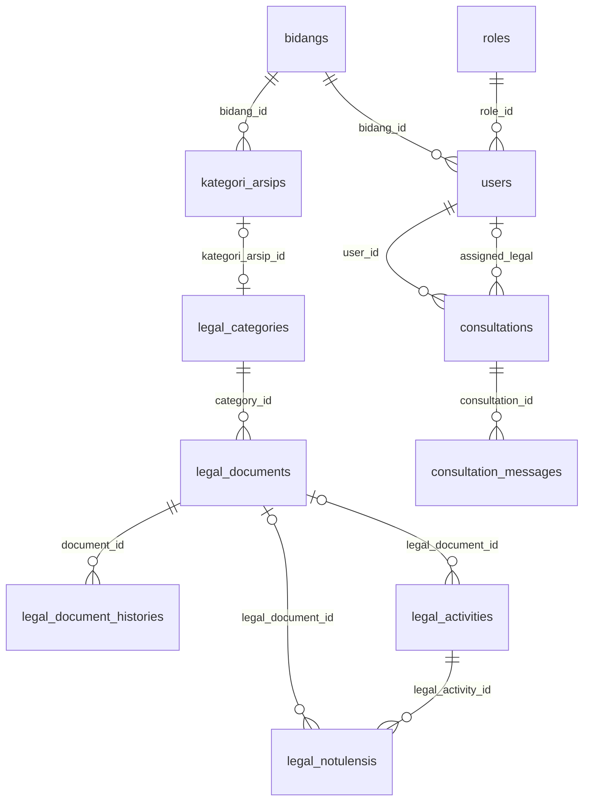

# Analisis implementasi SSO PDAM

Diperbarui: **27 Oktober 2026**. Dokumen ini menggantikan rencana tahap awal dengan peta implementasi yang sudah ada. Daftar berikut menjelaskan kode saat ini; bukan pernyataan seluruh fitur siap production.

Modul terbaru: **Pengarsipan CSR Humas**, dengan role/bidang Humas, kategori dari master Kategori Arsip Admin, lampiran privat, serta rekap Excel/PDF berdasarkan tanggal proses. Kolom Keluar diisi bebas oleh pengguna. Panduan penggunaan, pemasangan, struktur kode, dan pengujian tersedia di [HUMAS_CSR_MODULE.md](HUMAS_CSR_MODULE.md).

## Teknologi dan struktur

| Aspek | Implementasi |
|---|---|
| Backend | Laravel 10, PHP `^8.1` menurut `composer.json` |
| PHP lingkungan | CLI lokal 8.3 pada pengujian terakhir; Dockerfile memakai `php:8.2-fpm` |
| Autentikasi | Laravel Breeze, session, Blade |
| Database | Konfigurasi MySQL; suite regresi terpilih memakai SQLite dalam memori |
| Audit trail | Spatie Laravel Activitylog |
| PDF | `barryvdh/laravel-dompdf` |
| Frontend | Blade, CSS pada layout/partial, Vite + TailwindCSS, JavaScript; Alpine/Axios tersedia dalam dependency frontend |
| Deployment yang disediakan | Docker Compose: PHP-FPM, Nginx, MySQL, scheduler, phpMyAdmin |

Versi pada `composer.json`/`package.json` merupakan rentang dependency; versi terkunci ada di lockfile. Tidak ada pemeriksaan advisory dependency baru dalam pembaruan dokumentasi ini.

```text
app/
  Console/Commands/                 ResetActivityLog, RefreshLegalDocumentStatuses
  Http/Controllers/                 Controller modul dan Auth/
  Http/Middleware/                  RoleMiddleware, LegalModuleAccess, middleware akun/cache
  Models/                           Data inti, dokumen, konsultasi, notulensi/kegiatan Legal
  Services/LegalPrivateFiles.php     Validasi path privat dan gambar untuk PDF
config/legal.php                    Tanda tangan opsional laporan
resources/views/
  admin/, sekretariat/, staf/       Layout dan dashboard per role
  legal/                            Dokumen, konsultasi, kalender, kegiatan, notulensi, laporan
  employee/consultations/            Portal konsultasi pemohon
  library/                          Katalog dan detail dokumen terpublikasi
  layouts/sidebar-controls-style.blade.php
  arsip/, nomor-surat/, log-aktivitas/, auth/, components/
database/migrations/                Schema dan migration data bertahap
database/seeders/                    Master awal serta seeder akun sampel
routes/web.php                      Route aplikasi dan grup middleware
routes/auth.php                     Route autentikasi
```

Tidak ada lagi controller `LegalReportController` maupun view `legal/reports/index.blade.php`. Laporan aktif memakai `LegalMonthlyReportController` dan view `monthly`/`monthly-pdf`.

## Role, navigasi, dan akses

| Role | Halaman tujuan setelah login tanpa intended URL | Cakupan utama |
|---|---|---|
| `super-admin` | `/admin` | Bidang, kategori arsip/surat, pengguna, role, seluruh log |
| `sekretariat` | `/dashboard-sekretariat` | Arsip, nomor surat, notulensi dan laporan Sekretariat, portal konsultasi/perpustakaan |
| `staf-bidang` | `/staf` | Arsip bidang, upload, log sendiri, konsultasi sendiri, perpustakaan |
| `legal-admin` | `/legal/dashboard` | Dokumen Hukum, konsultasi, kalender, kegiatan/notulensi, laporan, perpustakaan |
| `humas` | `/humas/dashboard` | Arsip CSR bidang sendiri, rekap Excel/PDF, log sendiri, konsultasi dan perpustakaan |
| `employee` | `/employee/consultations` | Konsultasi sendiri dan perpustakaan |

`AuthenticatedSessionController::store()` memakai `redirect()->intended(...)`; intended URL dapat mendahului tujuan default. `/` mengarahkan ke login. `RouteServiceProvider::HOME` tetap `/dashboard`; jangan menganggap konstanta itu sebagai seluruh logika redirect login.

Nama organisasi sekarang **Sub Bidang Hukum**. Penggantian nama tidak mengubah role `legal-admin`, nama tabel, URL `/legal`, ID bidang, atau relasi data. Scope kategori menerima nama lama untuk kompatibilitas.

Antarmuka Admin tidak menampilkan pintasan Hukum/Perpustakaan. Portal Perpustakaan dan konsultasi memilih layout menurut role sehingga sidebar asal tetap terlihat. Kontrol hamburger bersama berada di `layouts/sidebar-controls-style.blade.php`, sedangkan layout Legal memiliki aturan setara sendiri. Tombol hamburger 42 × 42 px, dekat tepi sidebar, dengan drawer pada viewport maksimal 980 px.

Log Aktivitas hanya memberi seluruh log kepada Super Admin; role lainnya hanya causer akun sendiri, termasuk pencarian/pagination/detail. Kesamaan role atau bidang tidak memberi hak melihat log akun lain.

Keterbatasan yang masih ada: `RoleMiddleware::handle()` menerima satu argumen `$role`. Deklarasi `role:legal-admin,super-admin` belum memberikan akses role kedua sesuai maksud. Kegiatan/notulensi/laporan Legal memakai `LegalModuleAccess` khusus untuk kedua role; route Legal lama belum seluruhnya selaras. Akses konsultasi pada controller juga masih membedakan khusus `hasRole('legal-admin')`. Lihat A08 dalam [audit](AUDIT_SISTEM_2026-10-16.md).

## Pembaruan akses arsip Sekretariat — 26 Oktober 2026

Role `sekretariat` hanya dapat melihat arsip dengan `bidang_id` yang sama dengan akun, termasuk arsip rekan dalam bidang yang sama. `User::bisaAksesSemuaBidang()` selalu false untuk role ini, meskipun data lama bidang masih memiliki `akses_semua_bidang = true`. Role lain tetap memakai pengaturan akses bidang yang sudah ada; seeder baru menonaktifkan flag lintas bidang pada Sekretariat.

Menu Arsip Semua Bidang dihapus. Pembatasan berlaku pada daftar, pencarian, pagination, URL detail, dan unggah melalui kategori. `Arsip::visibleTo()` dipakai pada statistik enam bulan, rekap bulanan, dan data arsip laporan HTML/PDF Sekretariat. Endpoint `dashboard.rekap-bulanan` sekarang memerlukan `auth`, `aktif`, dan `nocache`, serta memvalidasi periode; A09 audit memiliki tindak lanjut terpisah.

Regresi ada di `tests/Feature/SecretariatArchiveAccessTest.php`, memakai SQLite dalam memori. Pembatasan metadata ini belum memigrasikan file Arsip lama dari disk public; risiko URL file langsung A01 tetap tercatat di panduan berkas/audit.

## Database dan relasi

| Kelompok | Tabel dan peran |
|---|---|
| Akun/master | `roles`, `bidangs`, `users`, `kategori_arsips`, `master_kategori_surat` |
| Arsip Sekretariat/bidang | `arsips`, `notulensis`, `arsip_surat` |
| Dokumen Hukum | `legal_categories`, `legal_documents`, `legal_document_histories` |
| Konsultasi | `consultations`, `consultation_messages` |
| Kegiatan/notulensi Hukum | `legal_activities`, `legal_notulensis` |
| Notifikasi | `legal_notifications` |
| Log | `activity_log` milik Spatie; tabel `activity_logs` lama sudah memiliki migration penghapusan |
| Infrastruktur Laravel | Token reset password, personal access tokens, failed jobs |

Relasi penting:

- `users.role_id` dan `users.bidang_id` menghubungkan akun dengan role/bidang.
- `kategori_arsips` milik bidang dan dapat mempunyai `parent_id`.
- `legal_categories.kategori_arsip_id` menghubungkan master kategori arsip ke kategori Hukum secara unik dan nullable.
- `legal_documents.category_id` mengarah ke kategori Hukum; `created_by` ke pengguna; riwayat mengarah ke `document_id`.
- `consultations.user_id` adalah pemohon, `assigned_legal` adalah PIC, dan `consultation_messages` mengarah ke konsultasi/pengirim.
- `legal_activities` memiliki tanggal/uraian, opsional dokumen Hukum, lampiran/foto, dan pembuat.
- `legal_notulensis.legal_activity_id` wajib, sedangkan dokumen Hukum opsional. Satu kegiatan mempunyai banyak notulensi.
- FK dokumen kegiatan/notulensi memakai null-on-delete; pembuat dan kegiatan yang masih dirujuk notulensi memakai restrict-on-delete.
- `notulensis` Sekretariat terpisah dari `legal_notulensis`; kesamaan ID bukan berarti record yang sama.



Field lengkap dan constraint definitif ada pada migration/model; diagram menyajikan relasi utama saja.

## Alur yang sudah diterapkan

### Kategori dan dokumen

Admin membuat kategori pada Kategori Arsip bidang Sub Bidang Hukum. Hook `KategoriArsip` menyinkronkan `LegalCategory`; form/validasi dokumen menggunakan scope master Hukum. Tidak ada master kategori Hukum terpisah dan seeder tidak menambahkan kategori default.

Dokumen dibuat sebagai `DRAFT`, kemudian ditelaah dan dinyatakan berlaku. Model menghitung `ACTIVE`/`EXPIRING_SOON`/`EXPIRED` berdasarkan tanggal, dan command harian menyinkronkan record tanpa edit manual. Batasnya 30 hari kalender, termasuk tanggal kedaluwarsa, dengan timezone `Asia/Makassar`. DRAFT/NEED_REVIEW tidak diaktifkan oleh scheduler.

Riwayat versi dokumen memiliki area scroll maksimal 360 px. Riwayat itu berbeda dari daftar `activity_log` global.

### Konsultasi

Status: `WAITING_REVIEW`, `ACCEPTED`, `SCHEDULED`, `ONGOING`, `FINISHED`. Migration menggabungkan `CLOSED` ke `FINISHED`.

Status/PIC/jadwal pada detail Legal disimpan melalui `fetch` tanpa reload. Tombol nonaktif berwarna abu-abu sampai ada perubahan valid. Antrean simpan, baseline nilai tersimpan, pesan hasil per form, dan sinkronisasi badge menjaga perubahan form lain tetap ada. Penugasan PIC menetapkan ACCEPTED; jadwal menetapkan SCHEDULED. Server memberikan JSON untuk permintaan JSON dan redirect untuk form biasa. Diskusi masih memakai form biasa.

Pemohon hanya dapat mengakses konsultasi sendiri. Pilihan PIC pada UI tidak menggantikan validasi server; pembatasan role/akun aktif masih merupakan temuan A12.

### Notulensi, kegiatan, laporan

Form tambah dan riwayat kegiatan/notulensi Legal mengikuti pola Sekretariat. Controller dasar menyediakan validasi, transaksi, cleanup upload, dan endpoint lampiran privat. Controller Notulensi memperluas controller Kegiatan dan menggunakan view khusus Notulensi.

Notulensi memilih kegiatan yang ada atau membuat kegiatan otomatis dengan deduplikasi per pembuat/tanggal/judul/dokumen. Penghapusan kegiatan yang masih memiliki notulensi ditolak.

Laporan bulanan hanya mengambil `legal_activities` berdasarkan `tanggal_kegiatan`; satu baris per kegiatan. Lampiran/foto notulensi tidak ikut. PDF A4 landscape memuat header Sub Bidang Hukum PDAM, logo lokal, dokumentasi kegiatan, footer waktu, dan nomor halaman. Tanda tangan opsional dari konfigurasi. Rincian tersedia di [LEGAL_MODULE.md](LEGAL_MODULE.md).

### Perpustakaan dan notifikasi

Perpustakaan memerlukan login dan hanya menampilkan dokumen terpublikasi yang masih berlaku. Banner pencarian tetap ada dengan warna navy; dua baris judul tambahan di atas banner sudah dihapus. Kartu/form/tombol diselaraskan dengan halaman aplikasi dan filter kategori membungkus di layar sempit.

Pembaruan 26 Oktober 2026: halaman dan menu Notifikasi beserta route/controller antarmukanya dihapus. Model/tabel `legal_notifications` dan pencatatan pemberitahuan pada proses dokumen/konsultasi tetap ada.

## Penyimpanan dan pekerjaan terjadwal

Lampiran kegiatan/notulensi Hukum memakai `storage/app/legal-private` dan controller terotorisasi, dengan validasi path canonical/MIME. Modul lama masih menyimpan berkas pada `storage/app/public`; junction `/storage` atau alias Nginx diperlukan. Kondisi ini tetap membawa temuan akses URL langsung A01. Lihat [FILE_ACCESS.md](FILE_ACCESS.md).

`app/Console/Kernel.php` menjadwalkan:

| Command | Jadwal | Perilaku |
|---|---|---|
| `legal:refresh-document-statuses` | Harian 00.00 timezone aplikasi, tanpa overlap | Menyinkronkan status dokumen berlaku |
| `log:reset` | Tanggal 1 pukul 01.00 | Menghapus Activity Log lebih lama dari dua bulan |

Scheduler lokal memerlukan proses `schedule:work`, sedangkan Compose menyediakan service `scheduler` dengan loop `schedule:run` setiap menit. Keberadaan konfigurasi tidak membuktikan service production sudah berjalan. Rincian ada di [DOCUMENT_EXPIRY_AUTOMATION.md](DOCUMENT_EXPIRY_AUTOMATION.md).

## Pengembangan dan penerapan

Pada checkout baru, pasang dependency PHP/frontend dari manifest, siapkan `.env` untuk database yang dituju, dan buat APP_KEY khusus instalasi baru. Jangan mengganti APP_KEY aplikasi yang sudah berjalan sebagai langkah pembaruan rutin.

```powershell
composer install
npm install
npm run build
php artisan migrate
php artisan storage:link
php artisan optimize:clear
```

Untuk pengembangan, gunakan `php artisan serve`; `npm run dev` dapat menggantikan build aset selama pengembangan. Scheduler dijalankan pada terminal/proses terpisah. Jangan menjalankan `migrate:fresh` untuk deployment pembaruan data yang sudah ada.

Migration data penting setelah penambahan tabel Legal: penghubung kategori master (14 Oktober), penggabungan CLOSED (15 Oktober), serta penggantian nama bidang (20 Oktober). Migration rename sudah diterapkan lokal; status server lain harus diperiksa sendiri. Seeder Legal berisi akun sampel dan bukan langkah pembaruan production rutin.

Dockerfile sudah memasang GD. GD CLI lokal terdeteksi aktif pada 20 Oktober 2026. Frontend build, dependency di volume mount, koneksi database dalam container, hak tulis storage/cache, dan scheduler perlu dipastikan pada deployment. Compose yang tersedia merupakan konfigurasi development dan belum diverifikasi sebagai deployment production; rincian risikonya dipertahankan di laporan audit.

## Pengujian dan batas verifikasi

Pada **20 Oktober 2026**, suite terpilih lulus **29 test / 481 assertion**:

```powershell
php -d extension=pdo_sqlite vendor/phpunit/phpunit/phpunit tests/Feature/ActivityLogAccessTest.php tests/Feature/LegalDocumentExpiryTest.php tests/Feature/LegalActivityModuleTest.php tests/Feature/LegalCategoryMasterTest.php
```

Keempat kelas mengatur SQLite `:memory:` sendiri. `phpunit.xml` belum mengaktifkan isolasi database bagi seluruh suite; jangan menjalankan test bawaan yang memakai RefreshDatabase pada database operasional.

Pengujian terpilih mencakup modul Legal, laporan kegiatan, berkas privat, kategori, rename bidang, status tanggal, publikasi, layout lintas role, JSON konsultasi, dan log pribadi. Pemeriksaan ini tidak mengulang audit dependency atau membuktikan seluruh aplikasi aman. MySQL, runtime Docker, browser end-to-end, backup/restore, dan beban production belum dinyatakan terverifikasi.

[AUDIT_SISTEM_2026-10-16.md](AUDIT_SISTEM_2026-10-16.md) tetap menjadi catatan temuan keamanan/fungsional. A11 sudah diperbaiki; temuan lain belum boleh ditandai selesai hanya karena desain dan test regresi fitur berubah.

Verifikasi tambahan 26 Oktober 2026: jalankan perintah suite di atas dengan tambahan `tests/Feature/SecretariatArchiveAccessTest.php`. Hasil gabungan: **34 test / 583 assertion lulus**; termasuk validasi seluruh isian unggah dokumen dan isolasi arsip Sekretariat.
